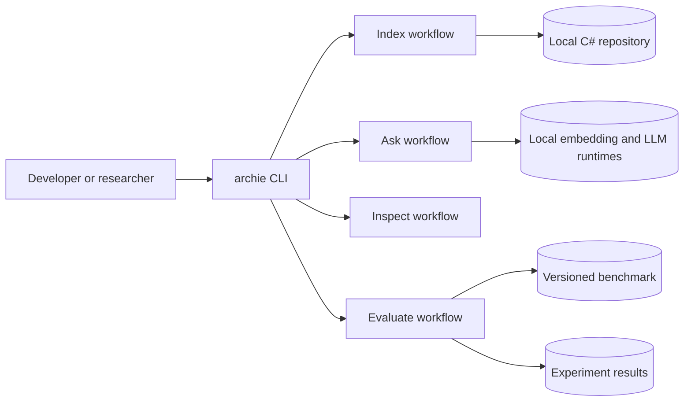
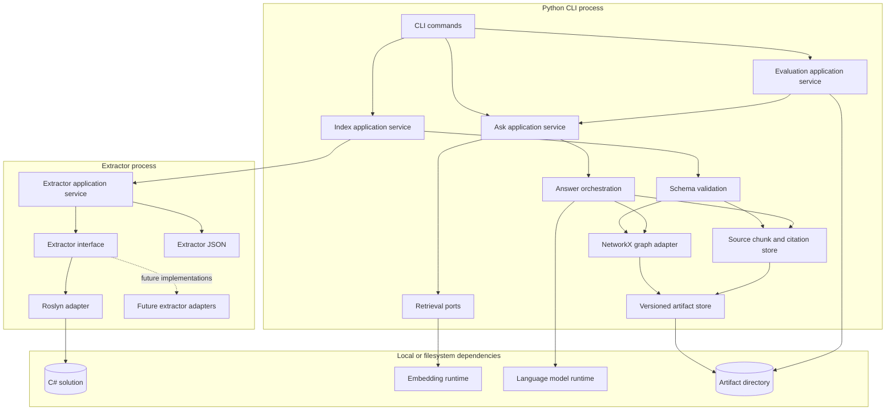
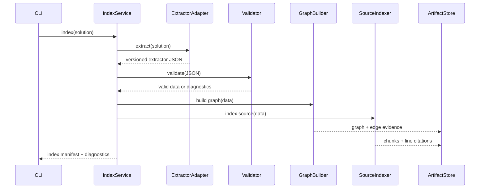
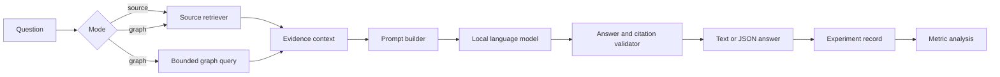
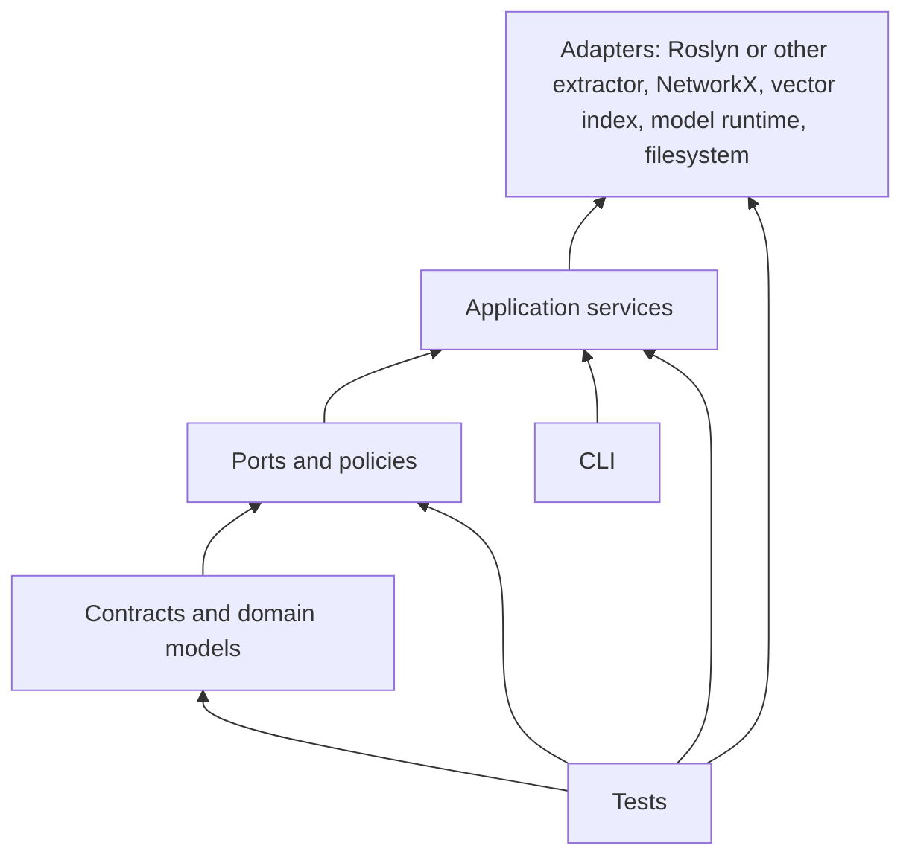

# ArchiE Graphs Software Architecture

Status: proposed

## Purpose

ArchiE Graphs V1 indexes a local C# solution, preserves source-backed dependencies, retrieves evidence, and compares source-only answers with graph-augmented answers from a local language model.

The architecture separates deterministic analysis from probabilistic retrieval and generation. Only deterministic components may create graph relationships or source citations.

## System context



## Runtime components



## Index data flow



## Ask and experiment flow



## Module responsibilities

| Module | Owns | Must not own |
| --- | --- | --- |
| `cli` | Parsing commands, formatting output, exit codes | Graph logic, model calls |
| `application` | Use-case orchestration and policies | Extractor, Roslyn, or NetworkX details |
| `contracts` | Versioned input/output models and validation | I/O, retrieval, prompting |
| `extractor` | Extractor interface and source-backed relationship contract | Python graph construction |
| `graph` | NetworkX construction and bounded queries | Source parsing, LLM decisions |
| `source` | Chunking, line metadata, citation lookup | Dependency inference |
| `retrieval` | Embedding and vector-search ports/adapters | Answer wording |
| `answering` | Evidence selection, prompt creation, answer validation | Creating unsupported evidence |
| `evaluation` | Benchmark execution, result records, metrics | Production query policy |
| `storage` | Atomic artifact reads/writes and manifests | Business decisions |

## Dependency direction



Rules:

1. Dependencies point inward toward contracts and policies.
2. Application services depend on interfaces, not any extractor implementation, Roslyn, NetworkX, a vector library, or a model runtime.
3. Adapters translate external data into domain contracts.
4. Each extractor remains behind the shared interface and emits the same versioned file or standard-output contract.
5. CLI handlers stay thin and call one application service per use case.

## SOLID application

### Single Responsibility

- `IndexService` coordinates indexing only.
- `GraphQueryService` answers graph queries only.
- `CitationValidator` validates citations only.
- `ExperimentRunner` runs benchmark cases only.
- File, model, embedding, and graph adapters each wrap one external concern.

### Open/Closed

- Add a model runtime by implementing `LanguageModel`.
- Add an embedding backend by implementing `EmbeddingIndex`.
- Add a graph query by extending the graph query policy and result contract.
- Do not change application services for adapter replacement.

### Liskov Substitution

- Every adapter must honor timeout, error, ordering, and metadata guarantees in its port.
- A fake adapter used in tests must return the same contract shape and failure semantics.

### Interface Segregation

Keep ports narrow:

```text
Extractor.extract(input) -> ExtractedIndex
GraphQuery.direct(node, limit) -> GraphResult
GraphQuery.paths(source, target, limits) -> GraphResult
SourceIndex.search(query, limit) -> EvidenceChunk[]
EmbeddingIndex.upsert(chunks) / search(vector, limit)
LanguageModel.complete(prompt, settings) -> ModelResponse
ArtifactStore.read/write(manifest, artifact)
```

### Dependency Inversion

- Use cases depend on ports.
- Composition root selects concrete adapters.
- Domain contracts never import infrastructure libraries.
- Tests inject fakes without starting an extractor, Roslyn, NetworkX, or a model runtime.

## Evidence and trust boundaries

1. Treat repository files and extractor output as untrusted input. Validate paths, schemas, sizes, and versions.
2. Only resolved extractor relationships become `EXTRACTED` graph edges.
3. Unresolved symbols become diagnostics or explicitly marked `UNRESOLVED` records.
4. `INFERRED` relationships, if added later, cannot be presented as source fact.
5. Every answer citation must resolve to an indexed file and valid line range.
6. Never send repository content to a remote service. Model adapters are local-only by contract.
7. Write artifacts atomically and keep failed experiment records.

## Contract schemas

The interchange boundary is JSON Schema Draft 2020-12. Schemas live in `schemas/`.

- `extractor-request.v1` and `extractor-result.v1` define the adapter boundary.
- `index-manifest.v1` defines artifact identity and publication state.
- `evidence-ref.v1` links claims to source spans, graph edges, or graph paths.
- `answer-record.v1`, `benchmark-question.v1`, and `experiment-record.v1` define evaluation data.
- `common.schema.json` defines IDs, source spans, diagnostics, nodes, edges, and claims.

Persisted objects reject unknown fields. Additive fields use a minor contract release. Changed meaning or removed fields requires a new major `vN` schema identifier.

### Canonical identity

- IDs use a namespace prefix, such as `project:App` or `type:App.CheckoutController`.
- Project identity is part of every symbol identity.
- Artifact paths are repository-relative, use `/`, and cannot contain `..`.
- Lines and columns are one-based and inclusive.
- Content hashes use lowercase `sha256:<64 hex digits>`.
- Producers sort persisted arrays deterministically.

### Extractor port

```text
probe(input) -> capabilities and diagnostics
extract(request) -> ExtractorResult
cancel(operation_id) -> acknowledgement
```

Adapters advertise capabilities. The Python pipeline consumes only the shared result contract and must not import Roslyn types or assume unsupported node kinds.

### Diagnostics and failure states

Every diagnostic has `code`, `severity`, `message`, `component`, and `recoverable`; optional path and source span identify the cause. Extractors return `succeeded`, `partial`, or `failed`. Indexes use `building`, `complete`, or `failed`.

### Artifact publication

1. Write to a temporary index directory.
2. Write a `building` manifest.
3. Validate artifacts and cross-references.
4. Set manifest to `complete` only after validation.
5. Rename the completed directory atomically.
6. Preserve `failed` manifests and diagnostics.

## Artifact layout

```text
artifacts/
  index/<index-id>/
    manifest.json
    extractor.json
    graph.json
    source-chunks.jsonl
    embeddings.index
    diagnostics.json
  experiments/<run-id>/
    run.json
    answers.jsonl
    metrics.json
```

Every manifest records schema versions, source commit or content hash, extractor interface version, adapter identity/version, model identities, configuration, and creation time.

## Testing strategy

- Unit tests: contracts, validators, graph algorithms, chunking, citation rules, prompt construction, and metrics.
- Contract tests: every adapter satisfies timeout, ordering, metadata, and error guarantees.
- Integration tests: fixture solution through extractor, index, graph query, retrieval, and answer validation.
- Golden tests: stable extractor JSON, graph query JSON, and CLI output.
- Evaluation tests: metric calculations on hand-built answers, including unsupported claims and missing citations.
- Reproducibility test: clean checkout runs the fixture workflow with fixed seed and produces valid manifests.
- Schema contract tests: valid fixtures pass; missing fields, unknown fields, invalid enums, bad paths, and incompatible versions fail.

## Non-functional rules

- Deterministic ordering for all persisted collections.
- Bounded graph traversal and bounded prompt context.
- Structured errors with actionable diagnostics.
- No global mutable state in application services.
- Explicit timeouts around external processes and model calls.
- Logs never include secrets or full source content by default.
